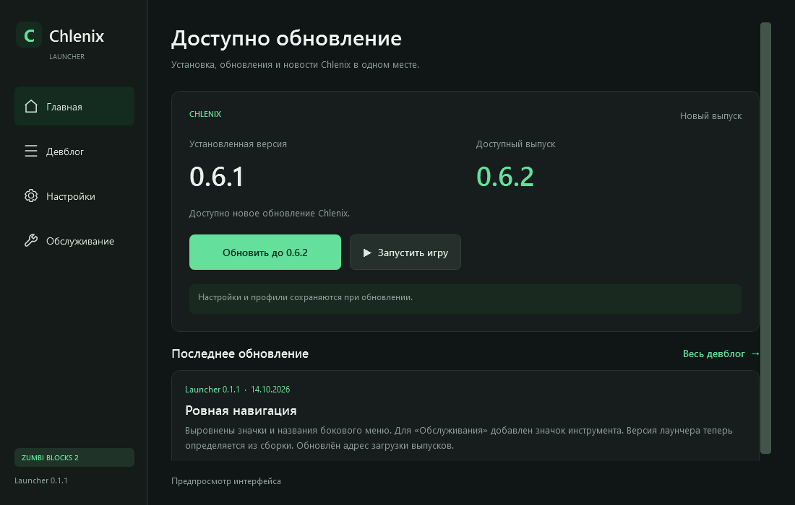

# Chlenix Launcher

Установка и обновления Chlenix для **Zumbi Blocks 2 Open Alpha** на Windows x64.

**[Скачать лаунчер](https://github.com/gatekeeper3s/chlenix-releases/releases/latest/download/Chlenix.Launcher.exe)** · [История выпусков](https://github.com/gatekeeper3s/chlenix-releases/releases)

## Как пользоваться

1. Скачай `Chlenix.Launcher.exe` и сохрани в удобную папку.
2. Открой лаунчер. Папка игры определяется из библиотек Steam; при необходимости выбери её в настройках.
3. Закрой игру и нажми **«Установить»** или **«Обновить до …»**. В Program Files Windows может запросить права для установки.
4. Запускай игру через лаунчер или Steam. Меню Chlenix — **F11**, переключение ESP — **F10**.

Лаунчер обновляет существующий Chlenix, включая прежнюю установку через консоль, и сохраняет настройки. Он показывает версии, новости и ход операции. В разделе обслуживания доступны восстановление, резервная версия и удаление собственного плагина.

При ошибке скачивания действующая установка сохраняется. Обновления проверяются по подписи и контрольным суммам. Для получения файлов регистрация не нужна. .NET включён в лаунчер; SDK устанавливать не требуется.

## Совместимость

Текущий плагин **0.6.2**, лаунчер **0.1.1**. Проверенная сборка игры: **Steam Build 24525702 / 2.1.6.1_free_alpha**. При несовместимой сборке замена файлов останавливается.

Исходники и игровые ресурсы в этом репозитории не публикуются. Небольшой пакет плагина лаунчер получает отдельно; полный EXE не требуется скачивать при каждом обновлении Chlenix.
